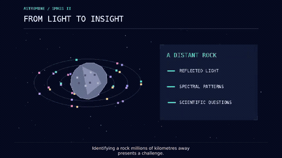

<div align="center">

# AstroMine

**Reading asteroid light. Learning asteroid families.**

*A machine-learning study of asteroid reflectance spectroscopy and Bus taxonomy.*

[Methodology](docs/methodology.md) · [Results](docs/results.md) · [AWS architecture](docs/aws-architecture.md) · [Data sources](#data-and-reproducibility)

</div>

---

## 🎬 AstroMine in action

<div align="center">



*An animated glimpse of AstroMine's asteroid spectroscopy and machine-learning workflow.*

[View the GIF](docs/AstroMine_README_Preview.gif)

</div>

## Overview

Asteroids reflect sunlight differently at different wavelengths. Their **reflectance spectra** reveal surface characteristics and can be used to organize objects into **spectral taxonomic classes**. AstroMine studies spectra from the **SMASS-II asteroid survey**, joins them to Bus taxonomy labels, and trains a class-weighted support vector machine to predict taxonomic categories.

> **Important distinction:** Spectral taxonomy is not a direct assay of minerals, metals, or extractable resources. AstroMine is an exploratory research prototype—not a mining feasibility evaluation.

## Research snapshot

| Metric | Recorded result |
| :-- | --: |
| Spectral files loaded | **1,341** |
| Wavelength features per asteroid | **197** |
| Spectral coverage | **0.435–0.925 µm** |
| Matched Bus classes | **25** |
| Classes included in the trained classifier | **24** |
| Training / held-out test spectra | **1,072 / 268** |
| **Held-out test accuracy** | **81.0%** |
| Held-out test balanced accuracy | **0.730** |
| Held-out test macro-F1 | **0.718** |
| Best three-fold cross-validation macro-F1 | **0.658** |

*Metrics are from saved outputs in the supplied notebook, not from a fresh cloud rerun. One object in the singleton O class was excluded from model training.*

## Method at a glance

```text
SMASS-II PDS spectra                 PDS taxonomy catalogue
          │                                   │
      parse tables                       clean Bus labels
          │                                   │
   discard all-zero rows             normalize asteroid IDs
          │                                   │
   align 197 wavelength bins ────────── match by ID / designation
          │
  interpolate only short interior gaps
          │
    stratified train/test split
          │
  median imputation → standardization
          │
  weighted RBF-SVM + 3-fold grid search
          │
        held-out evaluation
```

## Completed research

**Data preparation.** Loaded **1,341** asteroid spectra and examined a taxonomy catalogue of **2,615** rows. After cleaning, **1,443** catalogue entries carried usable Bus-class labels across **26** labels. Standardized identifiers and resolved six provisional-designation matches.

**Spectral processing.** Aligned each spectrum to a **197-bin wavelength grid** at **0.0025 µm** spacing. Removed **24 all-zero measurement rows**. Initially **11,341** spectral cells were missing; conservative interpolation filled **1,966**, leaving **9,375** for training-fold median imputation.

**Classification.** Built an 80/20 stratified split (1,072 training and 268 test spectra), compared a majority-class baseline and a weighted radial-basis SVM, and selected hyperparameters with three-fold cross-validation optimizing macro-F1. Best settings: **C=10, gamma=scale**.

**Evaluation.** The best configuration achieved **0.658 mean CV macro-F1**; the held-out test achieved **0.810 accuracy**, **0.730 balanced accuracy**, and **0.718 macro-F1**. Small class sample sizes limit how widely some individual class scores can be generalized.

For implementation details, caveats and per-class results, read [Methodology](docs/methodology.md) and [Results](docs/results.md).

## Repository guide

```text
README.md
docs/
  methodology.md             data handling and training design
  results.md                 evaluation summary and per-class scores
  aws-architecture.md        AWS roadmap and current cloud status
aws/
  athena_schemas.sql         illustrative Athena external-table DDL
scripts/
  export_spectra.py          local long-format CSV export
requirements.txt
.gitignore
```

**Note:** The full original Jupyter notebook and sample data are in the companion downloadable starter archive prepared for the project. The notebook is not yet published in this repository; it requires a separate upload. Do not mistake this repository for a fully reproducible training package until the notebook and source-data instructions are added.

## Data and reproducibility

Primary sources:

- SMASS-II PDS spectral survey: `EAR_A_I0028_4_SBN0001_SMASSII_V1_0`
- PDS taxonomic catalogue: `EAR_A_5_DDR_TAXONOMY_V6_0`
- [NASA PDS Small Bodies Node — SMASS-II](https://sbn.psi.edu/pds/resource/smass2.html)

The original notebook uses Kaggle-specific file paths. To run it on a local workstation, download and extract the PDS archives and update the local dataset paths in the notebook. Install common analysis dependencies with `pip install -r requirements.txt` before running experiments. Source dataset archives are not checked in here.

## AWS design — not yet deployed

```text
PDS archives → S3 raw → Glue ETL → S3 curated / Parquet
                                      │
                               Glue Data Catalog
                                      │
                                    Athena
                                      │
                           future model experiments
```

The [AWS architecture](docs/aws-architecture.md) is a **proposed workflow**, not an operational deployment. The connected AWS account currently reports S3 and Athena subscription/access problems and S3 Tables permissions errors; no AWS data uploads or model training have been completed.

## Next steps

- Publish the original research notebook and a small source-spectrum example.
- Add script-level tests and portable dataset-path configuration.
- Validate on independent spectra and study minority-class uncertainty.
- Add a 3D asteroid viewer only with independently verified orbital data.
- Enable AWS services, enforce cost controls, and validate raw-to-curated transformations.

---

<div align="center"><sub>AstroMine · asteroid spectroscopy × machine learning · research prototype</sub></div>